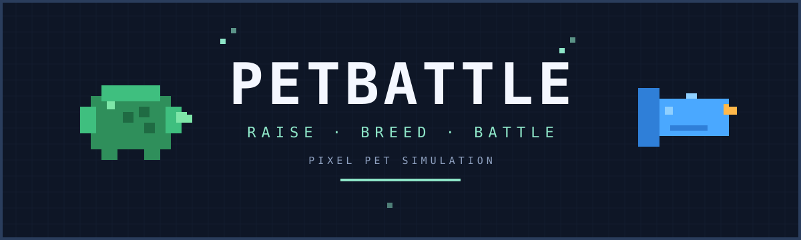
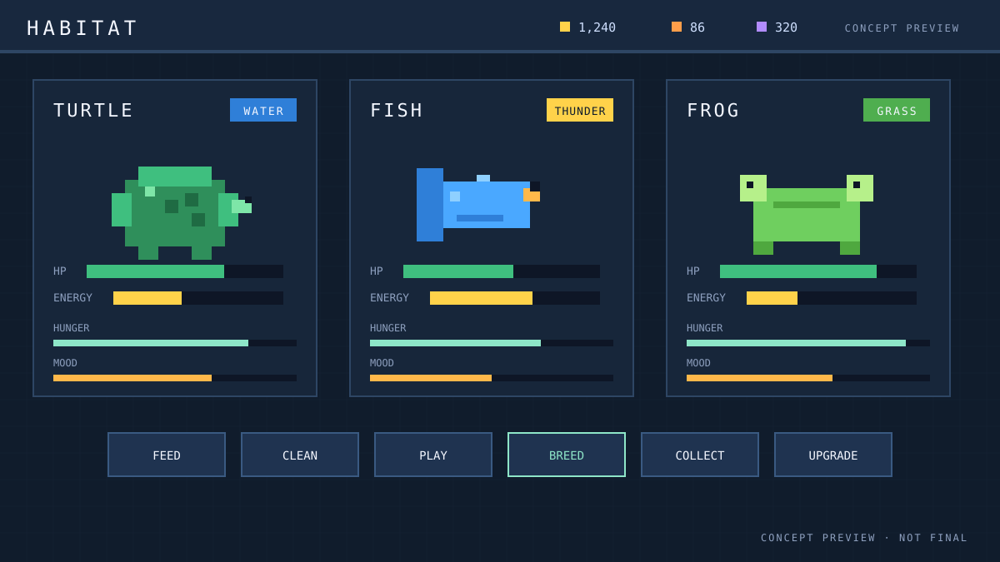

<h1>《宠物对决》PetBattle</h1>

<strong>一款以圈养、繁殖、基因收集为核心的像素风宠物养成游戏。</strong>

微信小游戏首发 · Steam 计划中 · Demo 免费 · 简体中文

  
  
  
  
  

> **开发状态：早期开发中，暂无试玩版。** 产品与技术文档已完成，正在搭建第一个可玩切片。如果你在 GitHub 看到这个项目，欢迎 Star / Watch 关注进度。

## 这是什么游戏

《宠物对决》是一款把“养宠物”和“轻策略对战”放在一起的像素风养成游戏。

你会经营一处小小的宠物栖息地：喂食、清洁、陪伴，看着宠物从蛋长到成年；通过配种把基因、属性和稀有特质传给下一代，养出独一无二的伙伴；最后带着自己养出来的三人小队去挑战关卡，和其他玩家的防守队伍交手。

游戏不逼你一直在线。离线也会积累产出，回来收菜、照料、繁殖，再打一两场，几分钟就能完成一轮。

## 核心玩法

- **圈养**：喂食、清洁、玩耍；饥饿、心情、清洁和健康会影响产出与战斗属性。
- **繁殖与基因**：物种和属性从双亲继承，数值基因带随机波动，稀有特质可能显性或隐性遗传；近亲繁殖有代价，突变可能带来惊喜。
- **相性与克制**：水、火、草、土、雷五种属性 × 五种物种（后续加入更多）。属性与物种有“契合 / 普通 / 冲突”相性，物种之间还有单向捕食克制。
- **3v3 回合制战斗**：按速度出手，管理精力，选择普攻、小技能或大招；支持自动战斗、2 倍速和跳过。
- **异步联机**：设置防守队伍，别人可以挑战你，你也可以挑战别人；战报可回放，排行榜记录段位。好友互访和实时好友房在后续计划中。
- **收集与图鉴**：记录见过的物种、属性组合、稀有特质和最佳基因；冲突组合也会成为收集目标。
- **放置但不逼肝**：离线最多积累 8 小时收益，适合碎片时间。

## 概念预览

  

> 概念示意图，用于展示界面方向，非最终画面。最终美术为像素风。

## 平台与发售

| 平台 | 状态 | 说明 |
|---|---|---|
| 微信小游戏 | 开发中（首发） | 横屏；打开即玩，无需下载安装 |
| Steam（Windows） | 计划中 | 桌面版；支持离线游玩、Steam 云存档与成就 |
| Demo | 免费 | 暂无试玩包；完成后会在此更新 |
| 语言 | 简体中文 | 首发仅中文，后续评估多语言 |

## 开发路线

| 阶段 | 内容 | 状态 |
|---|---|---|
| 文档与骨架 | 产品/技术/领域/联机/美术文档；Cocos + 核心包 + 服务器骨架 | 进行中 |
| 单机切片 | 圈养、成长、繁殖、放生、离线收益、1 场 3v3 | 计划中 |
| 联机核心 | 账号、云存档、异步 PvP、排行榜 | 计划中 |
| 微信首发 | 内容、像素美术、数值平衡、审核 | 计划中 |
| Steam | 桌面版、Steam 云存档/成就、跨端 | 计划中 |
| 后续 | 好友互访、交易、实时好友房 | 远期 |

> 没有承诺具体日期。早期项目，进度会随反馈调整。

## 常见问题

**免费吗？**
Demo 免费。正式版的商业模式（买断 / 广告 / 内购）还没定；MVP 不做付费点，也不做抽卡。

**必须联网吗？**
单机和 PVE 可以离线玩；账号、云存档、异步 PvP 需要网络。

**宠物会死吗？**
不会。宠物不会死亡，但你可以主动放生，换回基因尘。

**有抽卡吗？**
没有。宠物来自初始伙伴、关卡首通、繁殖和活动。

**为什么是像素风？**
像素风资源可控、风格统一，适合微信小游戏和 Steam 双端；也让每只宠物更容易做出辨识度。

**手机上能玩吗？**
首发是微信小游戏，横屏。Steam 桌面版在后续计划中。

**什么时候能玩？**
目前还没有试玩版。可以 Star / Watch 本仓库，或在 Issues 里关注进度。

## 关注与反馈

- 欢迎 Star / Watch 本仓库。
- 有问题、建议或想参与测试，欢迎开 Issue。
- 请不要在 Issue 里发布账号、密钥等敏感信息。

## 开发者

技术栈：Cocos Creator 3.x + TypeScript；纯 TS 领域核心（客户端/服务器共用）；Node + PostgreSQL（Demo 2C2G）。

- 开发文档索引：[docs/INDEX.md](docs/INDEX.md)
- AI 协作约定：[AGENTS.md](AGENTS.md)
- 分工与合并规则：[docs/COLLABORATION.md](docs/COLLABORATION.md)
- 踩坑记录：[docs/PITFALLS.md](docs/PITFALLS.md)

## 授权

本项目暂未选择开源协议；代码、文档与美术版权归作者所有。第三方字体、音频或素材需单独确认授权。

## 致谢

原创 IP。不使用任何已有作品的宠物形象、名称和美术。

---

<strong>RAISE · BREED · BATTLE</strong>

